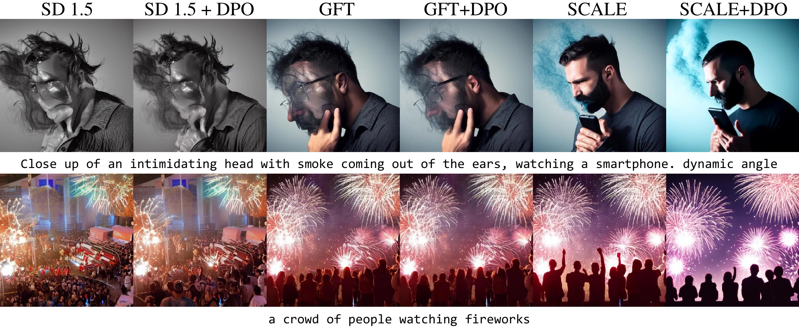
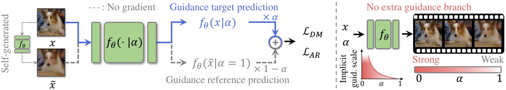

<div align="center">

<h1>SCALE: Improving Guidance-Free Visual Generation via Self-Contrastive Alignment for Likelihood Estimation</h1>

<p><strong>NeurIPS 2026</strong></p>

<p>
  <strong>Jiwan&nbsp;Hur &nbsp;·&nbsp; Dong-Jae&nbsp;Lee &nbsp;·&nbsp; Dongyeun&nbsp;Lee &nbsp;·&nbsp; Gyojin&nbsp;Han &nbsp;·&nbsp; Junmo&nbsp;Kim</strong><br>
  KAIST, South Korea
</p>

[](https://jiwanhur.github.io/SCALE/)
[](docs/assets/paper.pdf)
[](#-news)

</div>

**TL;DR:** SCALE learns from the contrast between real and self-generated samples during training, improving **guidance-free visual generation** with **one model evaluation per sampling step** in both diffusion and autoregressive models.

## Selected results



<p align="center">
  <strong>Guidance-free text-to-image generation with SD1.5, GFT, and SCALE, with and without DPO.</strong>
</p>

Guidance-free class-conditional generation on ImageNet 256 × 256. FID-50k ↓; lower is better.

| Model | Base | GFT | SCALE |
| --- | ---: | ---: | ---: |
| DiT-XL/2 | 9.62 | 1.99 | **1.87** |
| LlamaGen-L | 19.0 | 2.88 | **2.58** |

See the [paper](docs/assets/paper.pdf) for the full comparisons, text-to-image results, and experimental settings.

## Method

SCALE introduces **self-contrastive guidance (SCG)** by contrasting the model's predictions on real and self-generated samples. We reparameterize the likelihood training objective to learn this signal directly. **PatchMix** regularizes the reference by mixing patches from real and self-generated samples, providing a more reliable guidance anchor when generated samples are degraded.

At sampling time, the trained model directly produces the enhanced prediction in a single evaluation per step. The conditioning parameter controls the implicit guidance strength, with no additional guidance branch.

<p align="center">
  
</p>

<p align="center">
  <strong>Left:</strong> Learning self-contrastive guidance during training.
  <strong>Right:</strong> Guidance-free sampling with controllable generation.
</p>

## 🔥 News!!!

- **[2026/10]** Our paper has been accepted to **NeurIPS 2026**!
- **[2026/10]** The [project page](https://jiwanhur.github.io/SCALE/) and [paper](docs/assets/paper.pdf) are now available. **Training and sampling code will be released soon.**

## Citation

```bibtex
@inproceedings{hur2026scale,
  title     = {Improving Guidance-Free Visual Generation via
               Self-Contrastive Alignment for Likelihood Estimation},
  author    = {Hur, Jiwan and Lee, Dong-Jae and Lee, Dongyeun
               and Han, Gyojin and Kim, Junmo},
  booktitle = {Advances in Neural Information Processing Systems},
  year      = {2026},
  url       = {https://jiwanhur.github.io/SCALE/}
}
```
